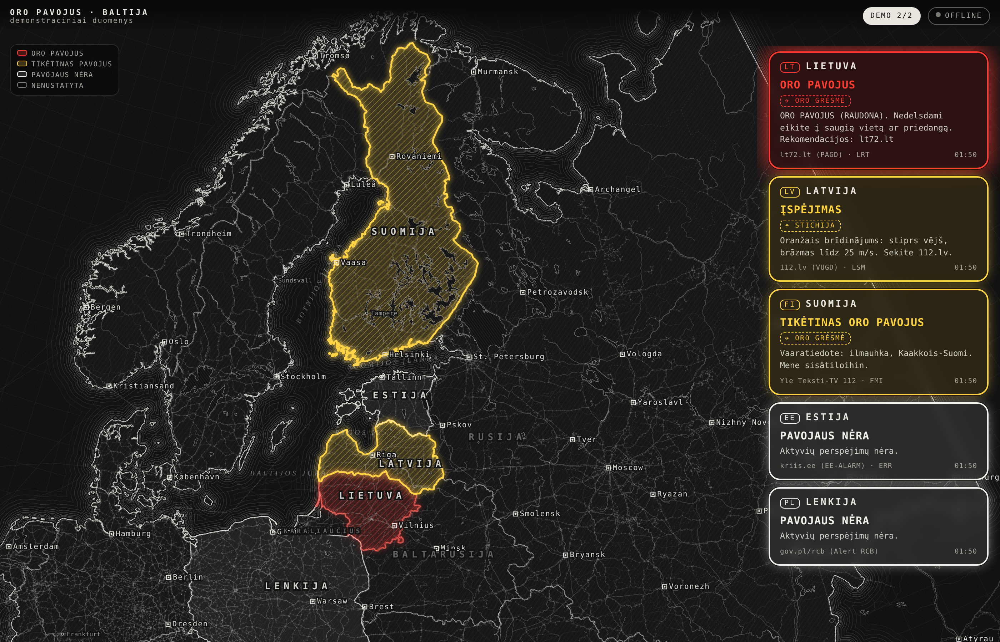

# Oro pavojus · Baltija (air-alert-map)

Tamsus, eskizo stiliaus žemėlapis, rodantis oficialius valstybinius įspėjimus: **oro pavojus (karas)** ir **stichija / tarša** Lietuvoje, Latvijoje, Estijoje, Suomijoje, Lenkijoje ir **Ukrainoje (sričių lygiu)**. Baltarusija, Rusija ir Karaliaučius piešiami kaip kontekstas, bet neturi viešų šaltinių, todėl jų įspėjimai nerodomi.



## Kaip atrodo
- Juoda–balta „pieštuko“ stilistika: vandens linijos aplink krantus, keliai, geležinkeliai, upės, ežerai su štrichais, regionų ribos punktyru, dvigubos sienų linijos.
- Šalis su pavojumi: permatomas spalvotas užpildas su štrichais ir šviečiantis kontūras (raudonas pulsuoja).
- Langeliai užapvalintais kampais: spalvotas kraštas, permatomas vidus, pavojaus lygis, tipas (✈ oro grėsmė / ☂ stichija / ☣ tarša), tekstas, šaltinis, laikas.

| Lygis | Spalva | Reikšmė |
|---|---|---|
| `red` | raudona | Oro pavojus / pavojingas reiškinys, slėptis |
| `yellow` | geltona | Tikėtinas pavojus / įspėjimas |
| `white` | balta | Aktyvių pavojų nėra (šaltinis veikia) |
| `none` | pilka | Nenustatyta: nėra duomenų arba šaltinis nepasiekiamas |

## Struktūra
```
index.html              ← SUBUILDINTAS, savarankiškas (veikia offline), atsidaryk naršyklėje
web/src.html            ← šaltinis: UI, stiliai, žemėlapio logika
data/map.topo.json      ← žemėlapio geometrija (Natural Earth 10m, apkarpyta)
data/alerts.example.json← duomenų formato pavyzdys
vendor/                 ← d3 v7, topojson-client (be CDN)
tools/build.py          ← src.html + vendor + data → index.html
tools/build_map.sh      ← perkuria map.topo.json iš Natural Earth
docs/                   ← šaltiniai, architektūra, ekrano nuotraukos
```

## Build
```bash
python3 tools/build.py        # → index.html
```
Pakeitus `web/src.html`, visada perbuildink ir commitink `index.html`.

## Duomenys
Puslapis kas 20 s kreipiasi į `alerts.json` šalia savęs. Nėra failo → rodoma „offline“, visos šalys pilkos. Mygtukas **Demo** perjungia demonstracinius scenarijus.

Formatas, raktai `LTU LVA EST FIN POL UKR` (UKR turi papildomą `regions: {"UA-63":"red"}`):
```json
{"LTU":{"level":"red|yellow|white|none","kind":"air|weather|chem|other","text":"…","time":"ISO8601","url":"…"}}
```

Šaltiniai: [docs/SOURCES.md](docs/SOURCES.md). Architektūra ir planas: [docs/ARCHITECTURE.md](docs/ARCHITECTURE.md).

## Statusas
- [x] Žemėlapis, stilius, langeliai, demo režimas
- [ ] Surinkėjas (Termux / Python), kuris pildo `alerts.json`
- [ ] Android APK: WebView + fono tikrinimas + notifikacijos
- [ ] Regionai (apskritys / novadai / maakonnad / województwa) vietoj visos šalies
